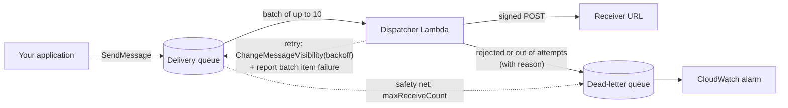

# sqs-webhook-dispatcher

[](https://github.com/NicollasFrazao/sqs-webhook-dispatcher/actions/workflows/ci.yml)
[](LICENSE)

Reliable webhook delivery on **AWS Lambda + SQS**, in TypeScript.

Your application drops a job on a queue and moves on. The dispatcher delivers it to the customer's URL, signs every request, retries with exponential backoff when the receiver is down, and parks what cannot be delivered in a dead-letter queue — with the reason attached and an alarm to tell you about it.

## How it works



Each SQS record is one delivery attempt, and its outcome decides what happens to the message:

| Receiver answered | Outcome | What happens to the message |
|---|---|---|
| `2xx` | delivered | Deleted from the queue |
| `5xx`, `408`, `425`, `429`, timeout, network error | retry | Visibility timeout set to the backoff delay; reported as a batch item failure, so it comes back later |
| any other `4xx`, `3xx`, invalid job | rejected | Sent to the dead-letter queue with the reason; not retried |
| still failing after `MAX_ATTEMPTS` | given up | Sent to the dead-letter queue with the last reason |

## Design decisions

- **Retries without a scheduler.** A failed message is not re-enqueued: the function sets its visibility timeout to the backoff delay and reports it as a [partial batch failure](https://docs.aws.amazon.com/lambda/latest/dg/services-sqs-errorhandling.html). SQS hands it back when the delay ends, and the attempt number comes from `ApproximateReceiveCount`.
- **Exponential backoff with full jitter.** The ceiling doubles per attempt (30 s, 60 s, 120 s… up to an hour) and the delay is random under it, so a receiver coming back from an outage is not hit by the whole backlog at once. A numeric `Retry-After` header wins over the policy.
- **Only retry what can succeed.** A `404` or `410` will not fix itself; retrying it for hours only delays the alert. Those go straight to the dead-letter queue.
- **Never lose a message.** If moving a message to the dead-letter queue fails, it stays on the main queue. The queue's own redrive policy (`maxReceiveCount = MAX_ATTEMPTS + 2`) catches anything that keeps crashing the function.
- **Bounded pressure.** The event source runs at most 10 concurrent invocations, so a large backlog does not turn into a flood against the receivers.
- **Signed and replay-resistant.** Every request carries an HMAC-SHA256 signature over the timestamp and the body. The key lives in Secrets Manager and is read once per container.
- **Idempotency is the receiver's job, and made easy.** Retries mean at-least-once delivery, so every attempt of the same job carries the same `X-Webhook-Id`.

## The request your customers receive

```http
POST /hooks HTTP/1.1
Content-Type: application/json
X-Webhook-Id: 0b9c6a3e-6f5d-4b8e-9a43-2a1f0c7d9e11
X-Webhook-Event: order.paid
X-Webhook-Attempt: 2
X-Webhook-Signature: t=1793548375,v1=5f2b…c9a1

{"id":"0b9c6a3e-6f5d-4b8e-9a43-2a1f0c7d9e11","event":"order.paid","data":{"orderId":"A-1001","total":42}}
```

Verifying it on the receiving side (Node.js, using this repository's `verify`):

```ts
import { verify } from './src/domain/signature.js';

app.post('/hooks', express.text({ type: 'application/json' }), (req, res) => {
  const ok = verify(process.env.WEBHOOK_SECRET!, req.body, req.get('X-Webhook-Signature') ?? '');
  if (!ok) return res.sendStatus(401);
  // Deduplicate on X-Webhook-Id before acting on the event.
  res.sendStatus(204);
});
```

The signature is computed over the raw body, so verify before parsing the JSON. Signatures older than five minutes are rejected.

## Enqueuing a delivery

```ts
import { SQSClient, SendMessageCommand } from '@aws-sdk/client-sqs';
import { randomUUID } from 'node:crypto';

await new SQSClient({}).send(new SendMessageCommand({
  QueueUrl: process.env.WEBHOOK_QUEUE_URL,
  MessageBody: JSON.stringify({
    deliveryId: randomUUID(),
    url: 'https://customer.example/hooks',
    event: 'order.paid',
    payload: { orderId: 'A-1001', total: 42 },
  }),
}));
```

Only `https` URLs are accepted.

## Project layout

```
src/
  domain/backoff.ts     exponential backoff with full jitter
  domain/signature.ts   HMAC signing and verification
  domain/delivery.ts    job parsing and one delivery attempt → outcome
  dispatcher.ts         SQS batch handling: retry, dead-letter, partial failures
  adapters/aws.ts       the queue port on SQS, the signing secret from Secrets Manager
  adapters/config.ts    settings from the environment
  handler.ts            Lambda entry point: wires the adapters into the dispatcher
infra/
  stack.ts              CDK stack: queues, function, secret, alarm
test/                   Vitest unit tests and CDK template assertions
.context/               context base for people and coding agents (start at .context/docs/README.md)
```

The domain code has no AWS dependency; the dispatcher talks to SQS through a two-method port, which is what keeps the tests fast and free of mocks of the AWS SDK. These layer rules are checked in CI by dependency-cruiser.

## Running it

Requirements: Node.js 22 and, to deploy, AWS credentials with a [bootstrapped](https://docs.aws.amazon.com/cdk/v2/guide/bootstrapping.html) CDK environment.

```bash
npm ci
npm test
npm run synth     # builds the bundle and the CloudFormation template
npm run deploy    # creates the stack in your account
```

The quality gate — lint (with `sonarjs` and TSDoc rules, no warnings allowed), typecheck, layer rules, unused code, tests with 80% coverage, synth and the context check — is one CI job per check; [CONTRIBUTING.md](CONTRIBUTING.md) lists the commands.

Configuration (environment variables of the function, set by the stack):

| Variable | Default | Meaning |
|---|---|---|
| `MAX_ATTEMPTS` | `8` | Attempts before giving up |
| `BACKOFF_BASE_SECONDS` | `30` | Ceiling of the first retry delay |
| `BACKOFF_MAX_SECONDS` | `3600` | Largest delay between attempts |
| `REQUEST_TIMEOUT_MS` | `10000` | Timeout of each request to the receiver |

## Possible next steps

- Per-endpoint circuit breaker, so one dead receiver does not use up the concurrency
- Redrive tooling for the dead-letter queue
- Delivery log (DynamoDB) exposed to customers

## License

[MIT](LICENSE) © Nícollas Frazão
